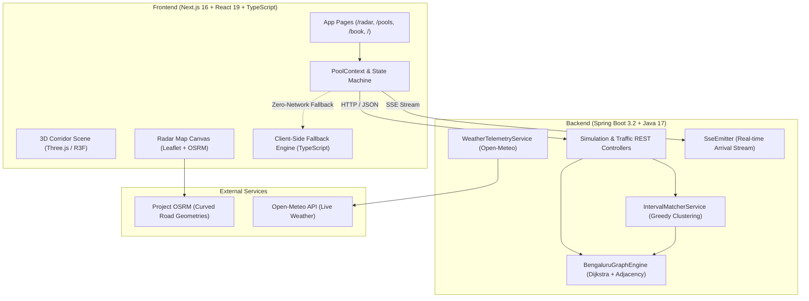

<div align="center">

# 🚗 CampusPool BLR
### High-Performance Graph-Theoretic Ride Matching Engine for Bengaluru's Transit Corridors

[](https://github.com/Viditsinghal18-collab/campuspool-blr/actions/workflows/ci.yml)
[](https://spring.io/projects/spring-boot)
[](https://www.oracle.com/java/)
[](https://nextjs.org/)
[](https://react.dev/)
[](https://www.typescriptlang.org/)
[](https://threejs.org/)
[](https://tailwindcss.com/)
[](http://localhost:8080/swagger-ui.html)
[](LICENSE)

<p align="center">
  <b>Solving urban university gridlock along Bengaluru's Mysore Road and Outer Ring Road corridors via algorithmic ride clustering, Dijkstra congestion re-weighting, and fair-share cost splitting.</b>
</p>

[Key Features](#-key-features) •
[Architecture](#-system-architecture) •
[Algorithms](#-mathematical--algorithmic-foundations) •
[Interactive Pages](#-interactive-web-pages) •
[API Reference](#-api-reference) •
[Quick Start](#-quick-start-guide) •
[License](#-license)

---

</div>

## 📌 Problem & Motivation

Bengaluru commuters and **RV College of Engineering (RVCE)** students face severe peak-hour bottlenecks along the **Mysore Road arterial corridor**, **Nayandahalli junction**, and **Outer Ring Road**. Solo cab hailing creates prohibitive financial burdens, compounding carbon emissions and highway gridlock.

**CampusPool BLR** is a full-stack mobility optimization platform engineered to cluster students and commuters travelling along shared transit paths into optimal pools of 2 to 4 riders. Powered by a graph-theoretic shortest-path engine and a greedy interval clustering algorithm, the system dynamically balances traffic choke points, real-time weather surges, and fair-share cost allocation.

---

## ✨ Key Features

- **🌐 Bengaluru Transit Graph Engine**: Models 11 key transit nodes and 15 arterial road segments connecting RVCE, Kengeri, Vijayanagar, Majestic, MG Road, Indiranagar, and Banashankari.
- **⚡ Dynamic Peak Traffic Dijkstra Rerouting**: Applies a $1.4\times$ choke multiplier to congested bottlenecks (Nayandahalli, Mysore Road, Majestic) during peak hours, dynamically calculating optimal alternative paths.
- **⏱️ Interval-Based Greedy Clustering**: Groups commuter requests based on temporal proximity (15-minute departure windows) and spatial overlap (minimum 2 shared corridor nodes).
- **💸 Fair-Share Fare & Savings Model**: Eliminates cost unfairness by computing exact rider-specific breakdowns: shared segment fare split evenly plus individual remaining trip fare.
- **🛰️ Interactive Fullscreen Live Radar**: Leaflet-powered GIS dashboard displaying live commuter requests, active carpools, and real curving road paths rendered via cached **OSRM road geometries**.
- **🌌 Cinematic 3D Corridor Hero**: Built with **Three.js** and **React Three Fiber**, featuring dynamic 3D station nodes, billboard text labels, starfield particles, and parallax motion.
- **🌧️ Live Open-Meteo Weather Surge**: Real-time Bengaluru weather telemetry fetching live temperature, precipitation status, and adjusting dynamic fare surges.
- **📡 Real-Time SSE Stream with Zero-Network Client Fallback**: Emits commuter arrivals over Server-Sent Events (SSE) with live re-clustering, paired with a complete client-side simulation engine enabling **100% functional offline/Vercel demo deployments**.

---

## 🏛️ System Architecture



---

## 🧮 Mathematical & Algorithmic Foundations

### 1. Shortest Path with Choke Point Scaling (Dijkstra)
For transit graph $G = (V, E)$ where $|V| = 11$ and $|E| = 15$:
$$d(v) = \min_{(u, v) \in E} \left( d(u) + w(u, v) \cdot \mu(u, v) \right)$$
Where:
- $\mu(u, v) = 1.4$ if Peak Traffic mode is enabled and either $u$ or $v \in \{\text{NAYANDAHALLI}, \text{MYSORE\_RD}, \text{MAJESTIC}\}$.
- $\mu(u, v) = 1.0$ during off-peak operations.

### 2. Geospatial Node Snapping (Haversine Formula)
Arbitrary pickup/drop-off coordinates $(\phi_1, \lambda_1)$ are snapped to the nearest graph node $(\phi_2, \lambda_2)$ using great-circle distance:
$$a = \sin^2\left(\frac{\Delta \phi}{2}\right) + \cos(\phi_1)\cos(\phi_2)\sin^2\left(\frac{\Delta \lambda}{2}\right)$$
$$d = 2 R \cdot \operatorname{atan2}\left(\sqrt{a}, \sqrt{1 - a}\right) \quad \text{where } R = 6371\text{ km}$$

### 3. Fair-Share Pool Savings Model
Standard carpooling apps unfairly compare solo fares to split shared fares while ignoring the remaining distance. CampusPool BLR enforces mathematically rigorous fairness:

1. **Solo Fare**: $\text{soloFare}_i = \operatorname{fare}(\text{source}_i \to \text{dest}_i) = \max(16 \cdot \text{distanceKm}, 30)$
2. **Shared Segment Share**: $\text{sharedShare} = \left\lceil \frac{\operatorname{fare}(\text{SharedCorridor})}{N} \right\rceil$
3. **Remaining Leg Fare**: $\text{remainingFare}_i = \operatorname{fare}(\text{SharedDropNode} \to \text{dest}_i)$ ($0$ if rider leaves at drop hub)
4. **Total Pooled Cost**: $\text{pooledTotal}_i = \text{sharedShare} + \text{remainingFare}_i$
5. **Rider Savings**: $\text{Savings}_i = \max\left(0, \frac{\text{soloFare}_i - \text{pooledTotal}_i}{\text{soloFare}_i}\right) \times 100\%$
6. **Cluster Average Savings**: $\text{ClusterSavings} = \frac{1}{N} \sum_{i=1}^N \text{Savings}_i$

---

## 🗺️ Transit Corridor Graph

| Station Node | Code | Latitude | Longitude | Primary Role |
| :--- | :--- | :--- | :--- | :--- |
| **RVCE Campus** | `RVCE` | `12.9237` | `77.4987` | Main University Origin Hub |
| **Pattanagere** | `PATTANAGERE` | `12.9244` | `77.4981` | Metro Purple Line Connection |
| **Kengeri** | `KENGERI` | `12.9172` | `77.4833` | Suburban Terminal & Bus Hub |
| **RR Nagar** | `RR_NAGAR` | `12.9275` | `77.5165` | Residential Feeder |
| **Nayandahalli** | `NAYANDAHALLI` | `12.9416` | `77.5256` | Outer Ring Road Choke Point |
| **Mysore Road** | `MYSORE_RD` | `12.9467` | `77.5301` | Arterial Highway Bottleneck |
| **Vijayanagar** | `VIJAYANAGAR` | `12.9709` | `77.5376` | Central West Node |
| **Majestic (KSR)** | `MAJESTIC` | `12.9767` | `77.5713` | City Rail & Intermodal Interchange |
| **MG Road** | `MG_ROAD` | `12.9756` | `77.6066` | Central Business District Hub |
| **Indiranagar** | `INDIRANAGAR` | `12.9784` | `77.6408` | Tech & Commercial Hub East |
| **Banashankari** | `BANASHANKARI` | `12.9152` | `77.5736` | South Ring Road Interchange |

---

## 🖥️ Interactive Web Pages

### 1. Landing Hero (`/`)
- Interactive **Three.js** 3D corridor visualization with starfield particles, station rings, and Billboard labels.
- Cinematic parallax background layer with reduced-motion accessibility support.
- Animated stat counters for CO₂ offset, commuters pooled, and average savings.

### 2. Live Radar (`/radar`)
- Fullscreen Leaflet map rendered edge-to-edge with automatic viewport size invalidation.
- Sequential road geometry rendering using **OSRM** curved polylines.
- Real-time commuters panel, live weather telemetry indicator, and live streaming simulation controls.

### 3. Active Pools (`/pools`)
- Card breakdown of matched clusters (2–4 riders per car).
- Visual corridor path badges, shared drop hub callouts, and rider-by-rider solo vs. pooled fare comparisons.

### 4. Book & Instant Match (`/book`)
- Interactive map interface allowing commuters to drop pins anywhere in South/West Bengaluru.
- Instant Haversine coordinate snapping to the nearest transit hubs.
- Real-time simulation insertion showing whether the ride forms a new pool or matches existing commuters.

---

## 📂 Repository Structure

```
campuspool-blr/
├── .github/
│   ├── workflows/
│   │   └── ci.yml               # GitHub Actions CI (Maven test + Next.js build)
│   ├── ISSUE_TEMPLATE/
│   │   ├── bug_report.md        # Standardized bug reporting template
│   │   └── feature_request.md   # Feature suggestions template
│   └── pull_request_template.md # Comprehensive PR template
├── backend/                     # Spring Boot 3.2 + Java 17 Application
│   ├── pom.xml                  # Maven dependencies & build configuration
│   └── src/
│       ├── main/java/com/rvce/campuspool/
│       │   ├── CampusPoolApplication.java
│       │   ├── config/          # OpenAPI & Web CORS configurations
│       │   ├── controller/      # REST API & SSE Streaming Controllers
│       │   ├── engine/          # Dijkstra Graph & Interval Matching Engines
│       │   └── model/           # Java 17 immutable record data models
│       └── test/java/com/rvce/campuspool/
│           └── BengaluruGraphEngineTest.java  # 19 unit & integration tests
├── frontend/                    # Next.js 16 + React 19 + TypeScript App
│   ├── app/                     # App Router pages (/, /radar, /pools, /book)
│   ├── components/              # 3D Corridor, MapCanvas, Navbar, ToastStack
│   ├── context/                 # PoolContext state machine & SSE handlers
│   ├── lib/                     # API client & client-side fallback simulation engine
│   ├── public/                  # Static assets & edge-geometry.json
│   └── package.json             # Frontend dependencies
├── .gitignore                   # Multi-stack ignore rules
├── LICENSE                      # MIT Open Source License
└── README.md                    # Project documentation
```

---

## 📡 API Reference

When the Spring Boot backend is active, explore interactive OpenAPI documentation at:
👉 **`http://localhost:8080/swagger-ui.html`**

| Method | Endpoint | Description |
| :--- | :--- | :--- |
| `GET` | `/api/graph/nodes` | Retrieve the 11 stations, adjacency lists, and current peak status. |
| `POST` | `/api/traffic/mode?peak={bool}` | Toggle 1.4x peak traffic Dijkstra edge weighting. |
| `POST` | `/api/simulation/seed` | Reset and populate graph with 15 commuter requests and cluster them. |
| `POST` | `/api/simulation/reset` | Clear all active requests and pool clusters. |
| `POST` | `/api/simulation/snap-and-request` | Snap arbitrary GPS coordinates to transit nodes and re-match. |
| `GET` | `/api/simulation/stream` | Server-Sent Events (SSE) live stream of commuter arrivals every 2.5s. |
| `GET` | `/api/weather/telemetry` | Fetch live Bengaluru weather and dynamic surge factor from Open-Meteo. |

---

## 🚀 Quick Start Guide

### Prerequisites
- **Java 17** or higher (OpenJDK / Temurin recommended)
- **Apache Maven 3.8+**
- **Node.js 18+** & **npm 9+**

### 1. Clone the Repository
```bash
git clone https://github.com/Viditsinghal18-collab/campuspool-blr.git
cd campuspool-blr
```

### 2. Run Backend (Spring Boot)
```bash
cd backend
mvn clean test
mvn spring-boot:run
```
*Backend runs at `http://localhost:8080`.*

### 3. Run Frontend (Next.js)
In a new terminal:
```bash
cd frontend
npm install
npm run dev
```
*Frontend runs at `http://localhost:3000`.*

---

## 🌐 Standalone Vercel / Offline Demo Mode

CampusPool BLR features an integrated, full **TypeScript port** of the Spring Boot matching engine in [`frontend/lib/fallbackEngine.ts`](frontend/lib/fallbackEngine.ts).

- When deployed to **Vercel** with `NEXT_PUBLIC_API_URL` left unset, the frontend makes **zero network calls** to a backend server.
- The UI displays `Demo mode` in the navbar status pill.
- The **Live Stream** runs a client-side simulated arrival interval every 2 seconds, generating live pool updates and green notifications without backend connectivity.

---

## 🧪 Testing & Verification

### Backend Tests
Execute the 19 automated unit tests verifying Dijkstra shortest path, choke point multipliers, interval matching clusters, and weather surge calculations:
```bash
cd backend
mvn test
```

### Frontend Typechecking & Production Build
```bash
cd frontend
npx tsc --noEmit
npm run build
```

---

## 👥 Contributors & Academic Attribution

Developed at **R.V. College of Engineering (RVCE)**, Department of Computer Science & Engineering, Bengaluru, Karnataka.

- **Vidit Singhal** — Lead Architect & Developer ([GitHub](https://github.com/Viditsinghal18-collab))

---

## 📄 License

This project is licensed under the [MIT License](LICENSE).
